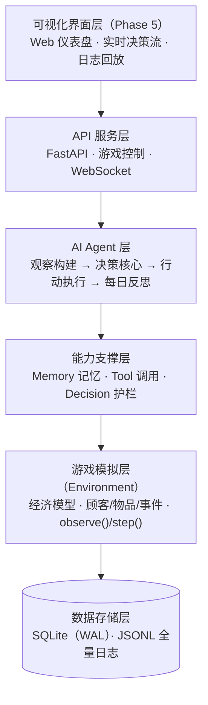

# 深空当铺 AI · 项目分析文档（Phase 1 交付物）

> **【归档说明 · 2026-10-13】** 项目方向已调整：不再自建模拟环境，改为 Computer Use Agent 直接操控真实 Steam 游戏客户端（见《02-视觉观察模块》）。本文档保留为历史设计参考，「自建游戏模拟层 / 经济系统」相关部分不再执行。

| 项 | 内容 |
|---|---|
| 项目名称 | 深空当铺 AI（Space Pawn Shop Simulator），工程代号 `spacepawn` |
| 文档性质 | Phase 1 项目分析：架构设计 + 技术选型 + 开发路线 + 风险分析 |
| 角色 | 高级 AI 游戏开发工程师 / 项目架构师 |
| 日期 | 2026-10-13 |
| 状态 | **待用户确认后进入 Phase 0** |
| 参考 | 仅学习该品类公开的玩法循环与设计思想；不使用任何商业资源（见 §6.5） |

---

## 0. 项目定位

> 一个**无头（headless）的太空典当经营模拟环境** + 一个能**自主感知、决策、行动并从经验中学习**的 AI 老板。

三个关键认知：

1. **这不是"做一个图形游戏给 AI 玩"的项目，而是"可复现的经营模拟实验室"**：游戏逻辑是纯代码，AI 是玩家，界面只是观察窗。Unity/Godot 这类渲染引擎对 AI 是纯开销。
2. **MVP 的成功标准不是画面**，而是：AI 能无人值守经营 10 个游戏日——不卡死、不崩溃、决策可回放、成本可计量。
3. **智能不来自训练模型**，而来自三层：提示词工程（即时判断）+ 记忆检索（历史经验）+ 每日反思（策略进化）。

设计参考（公开玩法循环，非商业资源）：日报情报 / 鉴定真伪 / 砍价收购 / 囤货定价 / 周期性租金 / 声望与风险。物品、NPC、事件、世界观全部程序化生成，内容原创。

---

## 1. 系统架构设计

### 1.0 架构总览



核心原则：**环境与 AI 完全解耦**。游戏模拟层对 AI 一无所知（可独立运行、独立测试）；AI 只通过 `observe() / step()` 标准接口与游戏交互。收益：游戏逻辑可脱离 LLM 测试、同 seed 完全可复现（A/B 与回放的地基）、换 Agent 框架不动游戏一行代码。

### 1.1 七个子系统

#### ① 游戏模拟层 Environment —— "游戏本身"
- **职责**：完整实现游戏规则，零 AI 依赖，可独立运行与测试
- **标准接口**：`observe()` → 返回玩家可见状态；`step(action)` → 返回 (新状态, 收支, 是否终局)
- **部分可观察**（玩法核心）：物品真伪/真实价值必须"鉴定"才知道；顾客心理底价与身份不可见——信息不对称制造决策空间
- **确定性**：同一 seed → 同一世界，可复现、可回放、可 A/B 测试
- **核心模块**：经济模型（价格指数/品类热度/通胀）｜顾客生成（到访节奏/底价/诚实度/身份）｜物品系统（稀有度/真伪/瑕疵/禁忌品）｜事件系统（市场崩盘/势力冲突/旅游节/临检）｜声望系统

#### ② AI Agent 层 —— "AI 老板"
感知-决策-行动闭环 + 两条辅助线：
- **Observer 观察构建**：环境状态 → 紧凑结构化 JSON + 自然语言摘要（控制 token 用量）
- **Brain 决策核心**：LLM function calling，输出严格 JSON schema 的动作
- **Executor 行动执行**：调用 Tool → 环境 step → 结果回填上下文
- **Strategy 策略层**：每日开局先定"今日经营方针"（进攻/保守/清仓/转型），再进入执行
- **Reflector 每日反思**：日终生成日报 + 经验教训，写入记忆系统
- **Fallback 兜底策略**：LLM 不可用时的规则玩家，保证游戏永远能继续（详见 §6.2）

#### ③ Memory 记忆系统 —— "AI 的经验"
- **情景记忆 Episodic**：结构化事件 + 结果标签。例："第 3 天花 800 收的 SR 古董，第 7 天 2400 卖出 → 成功"
- **语义记忆 Semantic**：反思提炼的规律。例："商人 K-7 的货真品率高"、"崩盘日不囤货"
- **检索注入**：决策前按相关度取 top-k 记忆放入提示词。MVP 用 SQLite FTS5 关键词检索，Phase 3 升级 embedding 向量检索
- **巩固机制**：每晚去重、重要性打分、时间衰减

#### ④ Decision 决策系统 —— "怎么想"
- **决策流水线**：态势摘要 → 候选动作 → 效用评估 → 选定执行
- **混合决策**：常规交易 LLM 直判；大额决策（投资升级）LLM + 规则双校验
- **效用函数**（规则侧，给 LLM 提供参考数据而非替代 LLM）：`期望收益 = 鉴定后价值 × 成交概率 − 成本 − 风险折扣`
- **护栏 Guardrails**：动作白名单、资金充足性、单日步数上限、输出 schema 校验

#### ⑤ Tool 调用系统 —— "AI 的手"
每个工具 = 一个环境动作或查询，严格 JSON schema + 人类可读描述 + 错误反馈（非法调用返回纠正提示，不抛异常）：

| 工具 | 作用 |
|---|---|
| `appraise` | 鉴定物品（花钱，揭示真伪与真实价值，有准确率） |
| `negotiate` / `counter` | 出价 / 还价（协议化谈判，见 §2.3） |
| `buy` | 收购成交 |
| `list_price` | 库存挂牌定价 |
| `repair` / `discard` | 修复瑕疵 / 丢弃垃圾 |
| `search_market` | 购买市场情报 |
| `check_inventory` / `check_finance` | 查询库存 / 财务 |
| `upgrade` | 投资升级店铺（鉴定仪/陈列柜/安保/库容） |
| `end_day` | 结束当天，进入结算 |

#### ⑥ 数据存储系统 —— "黑匣子"
- **SQLite（WAL 模式）**：游戏状态快照｜交易账本｜库存｜行情历史｜决策日志｜记忆表
- **JSONL 文件**：每次 LLM 的原始请求/响应——调试与回放的黄金数据
- **原则：一切可回放**。给定 seed + 决策日志，可完整重放任意一天

#### ⑦ 可视化界面 —— "观察窗"（Phase 5）
- Web 仪表盘：资产曲线｜库存看板｜市场行情｜实时决策流｜顾客互动回放
- 控制：开始 / 暂停 / 单步 / 调速 / 跳日；任意历史日回放
- 技术：FastAPI + WebSocket + ECharts，纯静态前端

### 1.2 横切关注点
配置（YAML + pydantic 类型安全）｜日志（structlog → JSONL 全量）｜测试（pytest + MockLLM，无网可测）｜成本（token 日预算，超限自动降级）｜防卡死（看门狗，见 §6.2）

### 1.3 一次顾客交互的数据流
顾客到访 → 环境生成 observation → Observer 压缩 → Brain（LLM + 记忆检索）→ 输出 action JSON → Guardrails 校验 → Tool 执行 → 环境 step → 账本/日志落库 → 循环 → 日终 Reflector 反思 → 记忆巩固

---

## 2. 游戏规则设计（MVP 版）

### 2.1 单日循环
早晨情报（日报/行情/事件）→ 营业交易（顾客到访，单笔内循环：观察→LLM 决策→执行→反馈）→ 傍晚整理（库存维护与定价）→ 夜间结算（成交/租金/声望）→ 深夜反思（日报 + 记忆巩固）→ 进入下一天

### 2.2 实体
- **物品**：名称/品类/稀有度(N/R/SR/SSR)/真伪/瑕疵/禁忌标记/真实价值/当前市值
- **顾客**：身份（拾荒者/反抗军/治安员/落魄精英…）/携带物/心理底价/要价/诚实度/耐心
- **店铺**：现金/库存/声望/评级/升级项（鉴定仪/陈列柜/安保/库容）
- **市场**：各品类价格指数/热度/进行中的事件

### 2.3 数值草案（全部可配置，Phase 1 调优）

| 参数 | MVP 值 | 说明 |
|---|---|---|
| 初始资金 | 10,000 星币 | |
| 日固定成本 | 租金 200 + 维护 50 | 周期性上涨，制造压力 |
| 顾客到访 | 每日 5~12 人 | 泊松分布 |
| 真品率 | ~80% | 赝品价值 -90%，瑕疵品 -30% |
| 顾客心理底价 | 真实价值 × 0.55~0.75 × 急迫系数 | 对 AI 不可见 |
| 顾客要价 | 底价 × 1.2~1.5 | |
| 鉴定 | 花费 50，准确率 90% | 可升级至 99% |
| 谈判协议 | 最多 3 轮 | 还价须在 [底价×0.9, 要价×1.05] 内，否则顾客流失 |
| 出售成交概率 | f(挂牌价/市值, 声望, 品类热度) | |
| 胜负 | 60 天净资产 ≥ 100,000 为胜 | 现金 < 0 且库存枯竭 = 破产；被临检查抄禁忌品 = 巨额罚款 |

---

## 3. 技术选型

### 3.1 选型总表

| 层 | MVP 选择 | 备选 / 演进 | 理由 |
|---|---|---|---|
| 后端语言 | Python 3.12+ | — | AI 生态最全；单进程足够 |
| 包管理 | uv | poetry | 快、lock 文件、环境隔离 |
| LLM 接入 | OpenAI 兼容客户端（自封装薄层） | — | **一套代码切换 DeepSeek / 通义 / 智谱 / Kimi / 豆包 / OpenAI / Ollama** |
| Agent 编排 | **自研轻量循环（约 200 行）** | Phase 3+ 迁 LangGraph / OpenAI Agents SDK | 完全可控、零锁定、易调试；当前流程简单到不需要框架 |
| 数据库 | SQLite（WAL） | Phase 4 迁 PostgreSQL | 零配置、可直接查看、单写入者无并发问题 |
| 检索 | SQLite FTS5 关键词 | Phase 3 加 embedding 向量 | 免引入向量库，MVP 够用 |
| 配置 | YAML + pydantic | — | 类型安全、注释友好 |
| 日志 | structlog → JSONL | Langfuse（可选） | 全量可回放 |
| 测试 | pytest + MockLLM | — | 无网可测、可复现 |
| 可视化 | FastAPI + WebSocket + ECharts | Streamlit（临时面板更快） | 轻量、支持回放控制 |
| 部署 | 本地单进程 | Docker（可选） | MVP 无并发需求 |

### 3.2 Agent 框架对比与结论（2026-10 调研）

| 框架 | 优势 | 劣势 | 本项目定位 |
|---|---|---|---|
| **LangGraph** | provider 无关、显式状态图、checkpoint 持久化一流、多模型路由 | 学习曲线陡、需要先设计图 | Phase 3-4 出现"反思链/断点恢复/多 Agent 编排"需求时迁移的首选 |
| **OpenAI Agents SDK** | OpenAI 生态内最快落地（tools/handoffs/guardrails/tracing 开箱即用） | 与 Responses API 绑定深，国产模型需 LiteLLM 代理 | 备选；若全面 OpenAI 化可提前采用 |
| **AutoGen / CrewAI** | 多 Agent 对话/角色协作 | 单 Agent 经营循环里过重 | Phase 4 多店铺竞争时参考其模式，不作基础设施 |
| **自研轻量循环** | 零依赖、零锁定、200 行内、完全可控 | 无内置 tracing/持久化（我们用自己的 JSONL + SQLite） | **MVP 采用** |

**结论**：不要为了用框架而用框架。我们的循环本质是"观察→决策→执行"，function calling 交给 OpenAI 兼容层即可。等复杂度真实增长（多步骤反思链、崩溃恢复、多 Agent 编排）再迁 LangGraph——由于环境接口已标准化，迁移成本很低。

### 3.3 模型分层策略（成本控制）
- **交易决策**（高频，每天约 30-60 次调用）：轻量模型（DeepSeek-V3 / Qwen-Plus / GLM-4-Flash 级）
- **战略与反思**（低频高质量，每天 2-3 次）：强模型（DeepSeek-R1 / Qwen-Max / GPT 级）
- 配置化切换；设置**每日 token 预算上限**，超限自动降级到兜底策略
- 开发/测试期全程使用 **MockLLM**（确定性假响应），零成本跑通全流程，接真实模型只改配置

---

## 4. MVP 开发路线

| Phase | 目标 | 交付物 | 验收标准（可运行） | 预估 |
|---|---|---|---|---|
| 0 环境搭建 | 项目可运行 | 脚手架 / 配置系统 / SQLite schema / 日志 / seed | `simulate --days 1 --seed 42` 输出占位日报，DB 建表，日志生成 | 0.5 天 |
| 1 简单交易模拟 | 游戏本身可玩 | 完整经济模型 + 规则机器人玩家 | 同 seed 完全可复现；机器人 30 天有合理盈亏曲线 | 2-3 天 |
| 2 AI 自主经营（MVP 里程碑） | AI 接管店铺 | LLM Agent + 工具集 + 防卡死四层防线 + 决策日志 | **无人值守连续 10 天：零卡死、决策可回放、成本有统计** | 3-4 天 |
| 3 长期记忆 | AI 从经验学习 | 情景/语义记忆 + 每日反思 + 检索注入 | 固定 seed 下"记忆开 vs 关"A/B，开启后收益更高 | 2-3 天 |
| 4 多 Agent 竞争 | 市场博弈 | 多店铺并行 + 竞争定价 + 排行榜（必要时迁 PostgreSQL） | 3 个 AI 店铺同台 30 天，数据一致无锁死 | 3-4 天 |
| 5 图形界面 | 可观测可演示 | Web 仪表盘 + 回放器 | 浏览器实时观看；可暂停/单步/回放任意日 | 3-4 天 |

**MVP 边界声明**：Phase 0-2 完成即达到 MVP——"AI 老板能自己把店开起来，且我们完全看得见它在想什么"。Phase 3-5 是增强，任一砍掉都不影响 MVP 成立。每个 Phase 设验收门禁，不过不进下一阶段。

---

## 5. 文件目录结构

```
spacepawn/
├── pyproject.toml            # uv 管理依赖与项目元数据
├── README.md
├── .env.example              # API Key 配置样例（真实密钥不提交）
├── config/
│   ├── game.yaml             # 游戏数值：经济模型/刷新率/事件权重
│   └── agent.yaml            # Agent 配置：模型/提示词版本/token 预算
├── src/spacepawn/
│   ├── core/                 # 游戏核心：纯逻辑，零 AI 依赖
│   │   ├── models.py         #   Item/Customer/Shop/Market 数据模型
│   │   ├── economy.py        #   经济模型：价格指数/热度/通胀
│   │   ├── customers.py      #   顾客生成与行为（含议价协议）
│   │   ├── items.py          #   物品生成（程序化，原创命名）
│   │   ├── events.py         #   随机事件系统
│   │   └── simulation.py     #   模拟主循环（日 → 时段 → 顾客）
│   ├── engine/               # 环境接口层（Gym 风格）
│   │   ├── env.py            #   PawnShopEnv.observe() / step()
│   │   └── actions.py        #   动作空间定义与校验
│   ├── agent/                # AI Agent 层
│   │   ├── brain.py          #   LLM 决策核心（轻量循环）
│   │   ├── observer.py       #   观察构建（状态 → 紧凑 prompt）
│   │   ├── strategy.py       #   每日经营方针
│   │   ├── reflection.py     #   每日反思
│   │   └── fallback.py       #   规则兜底玩家
│   ├── memory/               # 记忆系统
│   │   ├── episodic.py       #   情景记忆
│   │   ├── semantic.py       #   语义记忆 / 经验规则
│   │   └── retrieval.py      #   检索注入（FTS5 → embedding）
│   ├── decision/             # 决策系统
│   │   ├── evaluator.py      #   效用评估
│   │   └── guardrails.py     #   决策护栏
│   ├── tools/                # Tool 调用系统
│   │   ├── registry.py       #   工具注册 + JSON schema
│   │   └── game_tools.py     #   游戏动作工具实现
│   ├── storage/              # 数据存储
│   │   ├── database.py       #   SQLite 连接（WAL）
│   │   ├── schema.sql        #   建表语句
│   │   └── repositories.py   #   数据访问层
│   ├── llm/                  # LLM 客户端抽象
│   │   ├── client.py         #   OpenAI 兼容封装（多 provider 切换）
│   │   ├── mock.py           #   MockLLM（测试用，确定性响应）
│   │   └── budget.py         #   token 预算与成本统计
│   ├── api/                  # Web 服务（Phase 5）
│   │   ├── server.py         #   FastAPI
│   │   └── ws.py             #   WebSocket 实时推送
│   └── cli.py                # 命令行入口
├── web/                      # 前端（Phase 5）
│   └── index.html            #   ECharts 仪表盘
├── scripts/
│   ├── run_simulation.py     # 无头运行模拟
│   └── replay.py             # 决策日志回放
├── tests/                    # pytest + MockLLM（无网可测）
├── logs/                     # JSONL 运行日志（gitignore）
└── docs/                     # 设计文档 / ADR 架构决策记录
```

---

## 6. 风险分析

### 6.1 最难的三个点
1. **LLM 决策的质量与稳定性**：幻觉动作、格式错误、策略漂移。→ 对策：严格 schema 校验 + 动作白名单 + 错误反馈重试 + 兜底层；提示词版本化管理 + 黄金场景回归测试。
2. **经济模型平衡**：太简单 AI 永远赚钱（无聊），太难永远破产（也无聊）。→ 对策：数值全部配置化；Phase 1 先用规则机器人调参；定义"有趣区间"（单笔收益方差大但期望为正）。
3. **"AI 是否变聪明"的度量**：不度量就无法优化。→ 对策：固定 seed 基准场景 + A/B（记忆开/关）+ 指标（净资产曲线/存活天数/单笔收益率/鉴定 ROI）。

### 6.2 防卡死专项设计（核心诉求，四层防线）

| 层 | 机制 |
|---|---|
| 输入层 | 观察数据 token 上限，超长自动截断 + 摘要 |
| 决策层 | LLM 调用超时 60s；重试 2 次（指数退避 + 上次错误反馈）；输出 schema 校验失败自动重试；连续 3 次失败 → 熔断 |
| 执行层 | 动作白名单校验（非法动作返回纠正提示而非异常）；单日步数上限（如 40 步）强制 `end_day`；单顾客交互轮数上限 |
| 兜底层 | 规则安全策略（不买超支付能力的货 / 高价必鉴定 / 挂牌价 = 成本 × 1.15）；看门狗监控主循环心跳，异常自动快照 + 恢复 |
| 观测 | 卡死 / 熔断 / 降级事件全部计数入日志，日报中可见 |

### 6.3 最容易失败的地方
1. **成本失控**：Agent 循环调工具极易烧 token。→ 日预算上限 + 模型分层 + MockLLM 开发 + 响应缓存（仅市场日报等确定性内容）。
2. **框架先行**：先用复杂框架把系统搭重，游戏循环还没跑通。→ Phase 门禁：每阶段验收不过不进下一阶段。
3. **不可复现的 bug**：LLM 随机性 + 无日志 = 调试地狱。→ seed 化 + 全量 JSONL 日志 + 回放工具。
4. **需求蔓延**：做着做着想加炼金/养鼠/剧情……→ MVP 边界声明（§4），新需求进 backlog 不进当前 Phase。
5. **提示词脆断**：模型升级后行为漂移。→ 提示词版本号 + 黄金场景回归测试。

### 6.4 必须简化的地方（MVP 明确不做）
- 不用 Unity/Godot：无头模拟 + Web 观察窗（AI 不需要画面，渲染是纯开销）
- 不做自由格式谈判：固定轮次 + 价格区间约束的协议化谈判
- 不引向量数据库：SQLite FTS5 起步
- 不引 Redis / 消息队列 / 微服务：单进程 + SQLite
- 竞争对手先用脚本 AI：LLM 多店铺是 Phase 4 的增强而非必需
- 不做云同步 / 多人联机

### 6.5 IP 与合规
- 本项目为原创工程实验：不使用参考游戏的任何美术/音频/代码/文案；物品、NPC、事件、世界观均为程序化生成的原创内容
- 商业 API 密钥走 `.env`，不提交仓库；日志中的顾客对话等生成内容不写入真实个人信息

---

## 7. 待确认问题（阻塞 Phase 0）

1. **LLM 提供方**：DeepSeek（推荐：便宜稳定，function calling 好用）/ OpenAI / 其他国产（通义/智谱/Kimi/豆包）/ 暂未确定（先用 MockLLM 开发，Phase 2 再接）
2. **开发模式**：全自动开发 + 阶段验收（推荐）/ 每个 Phase 前确认 / 混合
3. **演示偏好**：命令行日志优先（推荐，最快看到 AI 经营）/ 尽快要 Web 界面 / 先要数据分析报告

## 8. 下一步

确认本文档 + 回答 §7 三问 → 进入 Phase 0（环境搭建），预计当天可运行占位模拟器。
