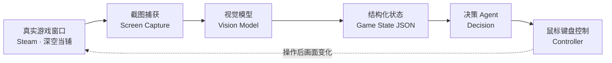

# 02 · 视觉观察模块（Vision Observation Module）设计文档

> 模块定位：Computer Use Agent 的「眼睛」。
> 状态：v0.1.0 已实现（2026-10-13）· 等待实测。

## 1. 背景与项目方向

项目目标：让 AI **自主游玩真实运行中的 Steam 游戏**《深空当铺：可能是偷得》（Probably Stolen）。
原则（用户指定）：不重制游戏、不创建模拟版游戏、不生成文字版替代环境。

整体流水线（Computer Use Agent）：



本阶段交付 **B + C + D**（视觉观察模块），E / F 为后续模块。

## 2. 模块范围

### 做
1. 捕获 Steam 游戏窗口画面（优先级：PrintWindow 后台抓取 → 抓屏回退）
2. 保存截图到 `artifacts/screenshots/`（PNG，毫秒级时间戳命名）
3. 调用视觉模型分析（OpenAI 兼容接口；内置离线 Mock 供无 Key 开发）
4. 返回结构化状态（4 个核心字段 + 可选 `visible_info` 扩展）

### 不做（后续模块职责）
- 鼠标 / 键盘控制（controller 模块）
- 决策逻辑（brain 模块）
- 任何形式的游戏模拟、文字版替代环境

## 3. 代码结构

| 文件 | 职责 |
|---|---|
| `game_agent/vision/window.py` | 窗口定位：Win32 枚举、关键词匹配、DPI 感知（Per-Monitor V2） |
| `game_agent/vision/capture.py` | 截图捕获：PrintWindow 后台抓取 + 抓屏回退 + 有效性检查 |
| `game_agent/vision/analyzer.py` | 视觉模型：提示词、OpenAI 兼容客户端、Mock 客户端、JSON 提取与重试 |
| `game_agent/vision/models.py` | 数据结构与输出契约校验（`validate_observation`） |
| `game_agent/vision/observer.py` | 观察流水线：一步完成 窗口→截图→分析→落盘 |
| `game_agent/cli.py` | 命令行：`list-windows` / `capture` / `observe` |
| `config/agent.json` | 配置：窗口关键词 / 视觉模型 / 路径 |

## 4. 输出契约（对下游的稳定接口）

```json
{
  "screen_state": "customer_offer",
  "available_actions": ["查看物品", "鉴定物品", "出价收购", "拒绝"],
  "important_objects": [
    {"name": "机械表", "type": "item", "value": "顾客开价 120", "position": "center"}
  ],
  "confidence": 0.85,
  "visible_info": {
    "money": "1840", "time_or_day": null, "inventory_summary": null,
    "dialogue": "顾客：这可是好东西，给个价吧。", "market": null
  }
}
```

| 字段 | 类型 | 说明 |
|---|---|---|
| `screen_state` | str | 界面枚举：`main_menu` / `day_start_news` / `shop_counter` / `customer_offer` / `negotiation` / `inventory` / `market` / `upgrade_menu` / `dialogue` / `loading` / `unknown` |
| `available_actions` | [str] | 当前可执行操作（中文动词短语） |
| `important_objects` | [obj] | 关键对象：`name` / `type(item\|npc\|ui\|money\|text)` / `value` / `position` / `point`（可选：对象中心点截图坐标 `[x, y]`，供控制模块点击） |
| `confidence` | float | 0-1，模型自评置信度（下游应据此决定是否重看） |
| `visible_info` | obj? | 可选扩展：资金 / 日期 / 库存 / 对话 / 市场摘要 |

校验逻辑：缺失 4 个核心字段 → 解析失败 → 携带纠错提示自动重试一次；数值容错（confidence 夹到 [0,1]、字符串动作自动转数组等）。

## 5. 使用方式

### 5.1 环境准备
```bash
pip install -e .          # Pillow / requests / pywin32
```

### 5.2 常用命令
```bash
python -m game_agent.cli list-windows              # 列出所有可见窗口（排查标题）
python -m game_agent.cli capture --window 深空当铺  # 只截图
python -m game_agent.cli observe --mock            # 离线自检（不调 API）
python -m game_agent.cli observe                   # 真实观察（需配置视觉模型）
```

### 5.3 退出码（便于脚本化）
| 码 | 含义 |
|---|---|
| 0 | 成功 |
| 1 | 未知错误 |
| 2 | 未找到窗口 |
| 3 | 截图失败（黑屏 / 窗口失效） |
| 4 | 视觉分析失败（未配置 / 网络 / 解析） |

## 6. 视觉模型配置

`config/agent.json` → `vision` 段：

| 字段 | 说明 |
|---|---|
| `provider` | `openai_compat`（默认）或 `mock` |
| `base_url` | OpenAI 兼容服务地址（到 `/v1` 为止，代码会拼 `/chat/completions`） |
| `model` | 视觉模型名 |
| `api_key_env` | 存放 API Key 的环境变量名（默认 `VISION_API_KEY`，回退 `OPENAI_API_KEY`） |
| `json_response_format` | 是否请求 `response_format=json_object`（部分服务商不支持，默认关） |
| `max_image_side` | 发送前图像最长边（默认 1600，控制体积与成本） |

常见服务商示例（**以服务商官方文档为准**）：

| 服务商 | base_url 示例 | 模型示例 |
|---|---|---|
| OpenAI | `https://api.openai.com/v1` | `gpt-4o` |
| 阿里云百炼（兼容模式） | `https://dashscope.aliyuncs.com/compatible-mode/v1` | `qwen-vl-max` |
| 智谱开放平台 | `https://open.bigmodel.cn/api/paas/v4` | `glm-4v-plus` |

API Key 设置：
```bash
export VISION_API_KEY=sk-xxxx          # Git Bash（当前会话）
setx VISION_API_KEY "sk-xxxx"          # Windows 永久（新开终端生效）
```

## 7. 测试

### 7.1 单元测试（离线，无需游戏与 API）
```bash
python -m pytest tests/ -v
```
覆盖：输出契约校验、JSON 提取（含 Markdown 围栏 / 噪声文本）、Mock 客户端、
图像有效性判定（黑屏/纯色/渐变）、配置加载、窗口查找无匹配路径。

### 7.2 无游戏时的链路自检（已实测通过）

```bash
# 终端 1：打开内容已知的测试窗口（需要带 tkinter 的 Python，如系统 Anaconda；
#          托管 Python 精简版不含 tkinter。该脚本不依赖 game_agent 包）
C:\anaconda\python.exe scripts\make_test_window.py

# 终端 2：截图 + 完整观察（离线）
python -m game_agent.cli capture --window GameAgent-TestWindow
python -m game_agent.cli observe --window GameAgent-TestWindow --mock
```
截图内容应与测试窗口画面一致（六个彩色色块 + 中文标题），说明窗口定位与捕获链路正常。

### 7.3 手工实测步骤（需要真实游戏）
1. 启动 Steam →《深空当铺》→ 进入游戏（**窗口化/无边框模式**）
2. `python -m game_agent.cli list-windows` → 确认游戏窗口标题包含配置关键词
3. `python -m game_agent.cli capture --window 深空当铺` → 打开 `artifacts/screenshots/` 检查截图内容是否正确
4. `python -m game_agent.cli observe --mock` → 验证完整管线（输出为固定样例，属正常）
5. 配置视觉模型 + Key 后 `python -m game_agent.cli observe` → 检查结构化输出是否与实际画面一致

## 8. 已知限制与风险

| 编号 | 限制 | 现状 / 对策 |
|---|---|---|
| R1 | **独占全屏模式无法截图** | 必须窗口化/无边框运行；文档与报错信息均已提示 |
| R2 | PrintWindow 对部分 GPU 渲染窗口返回黑屏 | 已内置黑屏检测 + 自动回退抓屏（回退会短暂抢占前台焦点） |
| R3 | 视觉模型误读、幻觉 | `confidence` 字段 + 强 schema 校验 + 原始输出落盘；后续可加关键数字二次确认 |
| R4 | token 成本 | 每次观察一次多模态调用；已内置缩图（`max_image_side`）；后续可做区域裁剪 |
| R5 | 多显示器 / DPI 缩放 | 已声明 Per-Monitor V2 DPI 感知；坐标统一为物理像素 |
| R6 | 窗口遮挡 | 优先后台抓取，抓不到才置顶（置顶会打扰用户，产生警告信息） |

## 9. 下一步

- **controller 模块**：鼠标移动/点击、键盘输入、窗口管理（操作前后截图对比校验）
- **brain 模块**：消费本模块的结构化状态，输出 `{action, reason, confidence}`
- 手工实测反馈：如截图 / 识别存在问题，按 §7.2 的产物（截图 + `observations/*.json`）定位
